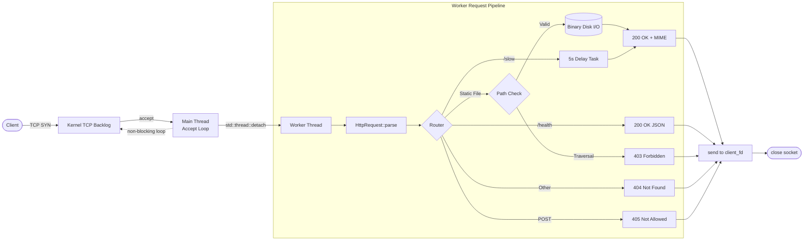

# ⚡ Vortex HTTP Server

A high-performance, multithreaded HTTP/1.1 web server engineered from scratch in modern **C++17** using low-level **Linux POSIX sockets** and a **thread-per-connection** concurrency model, completely free of third-party web frameworks.


---

## 🎯 Features

* **Zero-Framework POSIX Networking:** Direct Berkeley socket lifecycle (`socket`, `setsockopt`, `bind`, `listen`, `accept`, `recv`, `send`) with `SO_REUSEADDR` port recycling and RAII resource management.
* **Thread-per-Connection Concurrency:** Non-blocking connection dispatcher using `std::thread` and detached worker lifecycles (`thread.detach()`), ensuring heavy or delayed requests never block incoming client traffic.
* **HTTP/1.1 Protocol Engine:** RFC 7230 compliant parsing of request methods (`GET`, `POST`), URI routing, headers, and formatted HTTP responses (`200 OK`, `403 Forbidden`, `404 Not Found`, `405 Method Not Allowed`).
* **Binary File I/O & Dynamic MIME Resolution:** Binary-mode file streaming (`std::ios::binary`) supporting HTML, CSS, JavaScript, and binary images with dynamic file extension mapping.
* **Path Traversal Security Defense:** Canonical lexical path validation via `std::filesystem` preventing directory traversal (`../`) attacks targeting arbitrary host files.

---

## 🏛️ Architecture



---

## 🧩 Core Modules

| Module | Location | Responsibility |
| :--- | :--- | :--- |
| **`Server`** | `include/Server.hpp`, `src/Server.cpp` | Manages the socket lifecycle, accepts connections, and dispatches worker threads. |
| **`HttpRequest`** | `include/HttpRequest.hpp`, `src/HttpRequest.cpp` | Parses raw socket buffers into structured method, path, version, and headers. |
| **`HttpResponse`** | `include/HttpResponse.hpp`, `src/HttpResponse.cpp` | Constructs and serializes RFC-compliant HTTP status lines, headers, and payloads. |
| **`MimeTypes`** | `include/MimeTypes.hpp`, `src/MimeTypes.cpp` | Maps file extensions (`.html`, `.css`, `.png`, `.js`) to standard MIME types. |

---

## 🛠️ Build & Run

### Prerequisites
* Linux OS (Arch Linux, Ubuntu, Debian, Fedora, etc.)
* GCC 9+ or Clang 10+ (C++17 support)
* CMake 3.16+
* Make

### 1. Build
```bash
cmake -B build
cmake --build build
```

### 2. Run
```bash
./build/vortex
```
The server listens by default on port `8080` and serves static assets from `./public`.

---

## 🧪 Verification & Testing

### 1. Web Browser
Navigate to `http://localhost:8080/` to view the styled HTML/CSS dashboard.

### 2. Endpoints & MIME Resolution
```bash
# Static HTML
curl -i http://localhost:8080/

# Static CSS stylesheet with MIME detection
curl -i http://localhost:8080/style.css

# JSON health check
curl -i http://localhost:8080/health

# 405 Method Not Allowed
curl -i -X POST http://localhost:8080/

# 404 Not Found
curl -i http://localhost:8080/unknown
```

### 3. Concurrency Test
Simulate a slow client and verify non-blocking execution:
```bash
# Terminal 1: Starts a 5-second simulated heavy request
curl -i http://localhost:8080/slow

# Terminal 2: Run simultaneously in a separate terminal
curl -i http://localhost:8080/
```
*Result:* Terminal 2 returns the homepage instantly in sub-milliseconds without waiting for Terminal 1.

### 4. Path Traversal Security Test
*Note: Pass `--path-as-is` so curl does not normalize dots before transmitting over the wire:*
```bash
curl -i --path-as-is http://localhost:8080/../../../../etc/passwd
```
*Result:* `HTTP/1.1 403 Forbidden: Path Traversal Detected`

---

## 🔮 Future Enhancements

- [ ] **Thread Pool Architecture:** Replace thread-per-connection with a fixed worker thread pool to eliminate thread creation overhead under massive load.
- [ ] **`epoll` / Non-blocking I/O:** Transition from blocking I/O to Linux `epoll` event-driven architecture for C10K connection scalability.
- [ ] **HTTP Keep-Alive:** Support persistent TCP connections across multiple request/response cycles.

---

## 💼 Resume Bullet Points

* **Multithreaded HTTP Web Server | C++, POSIX Sockets, Linux, Multithreading**
  * Engineered a custom web server from scratch using modern C++17 and POSIX sockets to process concurrent HTTP requests without framework abstractions.
  * Implemented a thread-per-connection architecture using the C++ standard thread library (`std::thread`) to prevent I/O blocking and ensure sub-millisecond concurrent request throughput.
  * Parsed raw HTTP/1.1 wire requests and structured HTTP 200/403/404/405 response headers to serve local binary assets with dynamic MIME-type resolution and directory traversal security.
