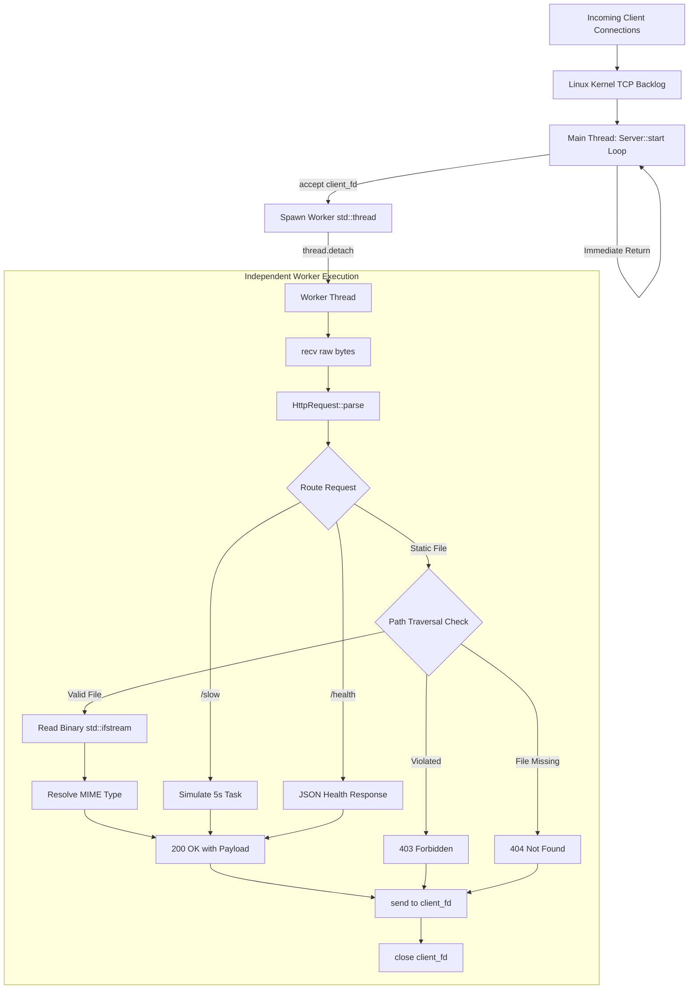

# ⚡ Vortex HTTP Server

A high-performance, multithreaded HTTP/1.1 web server engineered from scratch in modern **C++17** using low-level **Linux POSIX sockets** and a **thread-per-connection** concurrency model, completely free of third-party web frameworks or abstractions.


---

## 🎯 Features

* **Zero-Framework POSIX Networking:** Implements raw Berkeley socket primitives (`socket`, `setsockopt`, `bind`, `listen`, `accept`, `recv`, `send`) with `SO_REUSEADDR` port recycling and RAII socket lifecycle management.
* **Thread-per-Connection Concurrency:** Non-blocking request handling utilizing `std::thread` with detached worker lifecycles (`thread.detach()`), ensuring slow client connections never block the accept loop.
* **HTTP/1.1 Protocol Engine:** RFC 7230 compliant parsing of request methods (`GET`, `POST`), URI paths, headers, and formatted HTTP responses (`200 OK`, `403 Forbidden`, `404 Not Found`, `405 Method Not Allowed`).
* **Binary File I/O & Dynamic MIME Resolution:** Binary-mode file streaming (`std::ios::binary`) supporting HTML, CSS, JS, images (PNG, JPEG, SVG), and dynamic file-extension-to-MIME-type mapping.
* **Path Traversal Security Defense:** Canonical lexical path validation via `std::filesystem` preventing directory traversal (`../`) attacks targeting arbitrary system files.

---

## 🏛️ Architecture



---

## 🗺️ Project Roadmap

- [x] **Phase 1: RAII TCP Server**: Socket initialization, connection accept loop, and clean C++ RAII resource encapsulation.
- [x] **Phase 2: HTTP Parser & Dynamic Routing**: Request parsing (method, path, headers), structured response serialization, and routing (`/`, `/health`, 404, 405).
- [x] **Phase 3: Static File Serving & Security**: Binary disk streaming from `./public`, dynamic MIME mapping, and directory traversal security (`403 Forbidden`).
- [x] **Phase 4: Thread-per-Connection Concurrency**: Multithreaded request handling using `std::thread` preventing I/O starvation.

---

## 🛠️ Build & Run

### Prerequisites
* Linux OS (Arch Linux, Ubuntu, Debian, Fedora, etc.)
* GCC 9+ or Clang 10+ (C++17 support)
* CMake 3.16+
* Make

### 1. Build
```bash
cmake -B build
cmake --build build
```

### 2. Run
```bash
./build/vortex
```
The server listens by default on port `8080` and serves static assets from `./public`.

---

## 🧪 Verification & Testing

### 1. Web Browser
Navigate to `http://localhost:8080/` to view the styled HTML/CSS dashboard.

### 2. Endpoints & MIME Testing
```bash
# Static HTML
curl -i http://localhost:8080/

# Static CSS Stylesheet with MIME detection
curl -i http://localhost:8080/style.css

# JSON Health Check
curl -i http://localhost:8080/health

# 405 Method Not Allowed
curl -i -X POST http://localhost:8080/

# 404 Not Found
curl -i http://localhost:8080/unknown
```

### 3. Concurrency Acid Test
Simulate a long-running client and verify non-blocking execution:
```bash
# Terminal 1: Starts a 5-second simulated heavy request
curl -i http://localhost:8080/slow

# Terminal 2: Run simultaneously in a separate terminal
curl -i http://localhost:8080/
```
*Result:* Terminal 2 returns the homepage instantly in sub-milliseconds without waiting for Terminal 1 to finish.

### 4. Path Traversal Security Test
*Note: Pass `--path-as-is` so curl does not normalize dots before transmitting over the wire:*
```bash
curl -i --path-as-is http://localhost:8080/../../../../etc/passwd
```
*Result:* `HTTP/1.1 403 Forbidden: Path Traversal Detected`

---

## 💼 Resume Bullet Points

* **Multithreaded HTTP Web Server | C++, POSIX Sockets, Linux, Multithreading**
  * Engineered a custom web server from scratch using modern C++17 and POSIX sockets to process concurrent HTTP requests without framework abstractions.
  * Implemented a thread-per-connection architecture using the C++ standard thread library (`std::thread`) to prevent I/O blocking and ensure sub-millisecond concurrent request throughput.
  * Parsed raw HTTP/1.1 wire requests and structured HTTP 200/403/404/405 response headers to serve local binary assets with dynamic MIME-type resolution and directory traversal security.
